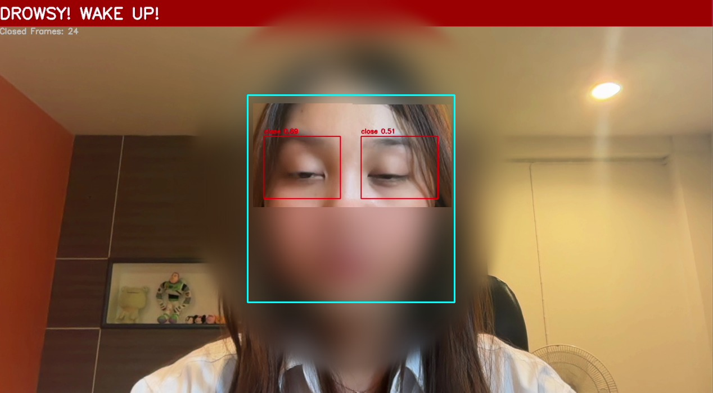

# Driver Drowsiness Detection

Real-time driver drowsiness detection from a webcam. **Haar Cascades** locate the face and eyes, each eye crop is classified as `open` or `close` by an **EfficientNetV2-B3** model (transfer learning, Keras), and once the eyes stay closed past a threshold the app flashes a warning banner and plays an alarm sound.

## Demo



*The face is deliberately blurred for privacy; the eye regions the model actually classifies are left sharp.*

---

## Quickstart

```bash
# 1) clone and enter the project
git clone https://github.com/Nuay-coder/Driver-Drowsiness-Detection.git
cd Driver-Drowsiness-Detection

# 2) create a virtual environment
python3 -m venv .venv
source .venv/bin/activate          # Windows: .venv\Scripts\activate

# 3) install dependencies
pip install -r requirements.txt

# 4) run
python drowsiness_detection.py     # press Q to quit
```

### Runtime requirements

- **A real webcam must be attached.** The script opens the camera with `cv2.VideoCapture(0)` and renders through a `cv2.imshow()` window, so it cannot run on Google Colab, a headless Docker container, or an SSH session with no display (`ret` comes back `False` and the loop exits immediately).
- On the first run macOS and Windows ask for camera permission — it has to be granted or no frames are read. On macOS the permission is attached to whichever app launched Python (Terminal / iTerm / VS Code); check System Settings → Privacy & Security → Camera.
- **Python 3.11 is the version this project is verified on** (see *Verified environment* below). `requirements.txt` sets no TensorFlow upper bound, so pip resolves the newest release your interpreter supports; on a very new Python, TensorFlow may have no matching wheel yet — in that case use 3.11.
- **Apple Silicon (M1–M4):** plain `pip install tensorflow` works natively on arm64 — the separate `tensorflow-macos` package is no longer needed. Add `tensorflow-metal` for GPU acceleration, though a model this size runs fine on CPU.
- **Linux:** `opencv-python` needs a GUI backend. If `cv2.imshow()` errors out, install `sudo apt install libgl1 libglib2.0-0`.
- Install from `requirements.txt` rather than installing packages one by one — `opencv-python` must stay on the 4.x line (OpenCV 5 removed the Haar cascade API this project uses).

### Verified environment

Last run end-to-end on this setup (macOS, Apple Silicon / arm64):

| | Version |
|---|---|
| Python | 3.11.18 |
| TensorFlow | 2.21.0 (Keras 3.15.1) |
| OpenCV | 4.14.0 |
| NumPy | 2.4.6 |
| pygame | 2.6.1 |

`best.keras` (97.4 MiB) and `Fahh.mp3` are committed to the repo, so a fresh clone runs as-is — no retraining needed.

`data.zip` (329.6 MiB) exceeds GitHub's 100 MiB limit and is gitignored. It is only needed to retrain the model; download it from the [MRL Eye Dataset on Kaggle](https://www.kaggle.com/datasets/tauilabdelilah/mrl-eye-dataset) (see [Dataset](#dataset)).

---

## Repository layout

| File | Purpose |
|---|---|
| `drowsiness_detection.py` | Real-time detection app (inference + alarm + overlay) |
| `Model.ipynb` | Training notebook (written for Google Colab) |
| `best.keras` | Trained model loaded by the main script |
| `Fahh.mp3` | Alarm sound |
| `haarcascade_frontalface_default.xml`, `haarcascade_eye.xml` | Haar cascades, loaded directly by the script |
| `data.zip` | Eye-image training set (not in the repo — download from Kaggle) |
| `screenshot.jpg` | Screenshot of the running app, shown at the top of this README |
| `requirements.txt` | Dependencies |

---

## How it works

1. Read a frame from the camera → flip horizontally → convert to grayscale.
2. `haarcascade_frontalface_default` detects faces (`minSize=(120,120)`).
3. Within the upper half of each face, `haarcascade_eye` detects eyes — if exactly two are found their bounding boxes are used, otherwise the code falls back to geometric crops at fixed proportions of the face box.
4. Each eye crop is resized to 150×150, converted to RGB, and classified as `open` / `close`.
5. Per-eye temporal smoothing with `deque(maxlen=5)` (majority vote) suppresses false positives from blinking.
6. When both eyes read as closed, `closed_frames += 1`; otherwise it decays by 1 (floored at 0).
7. At `closed_frames >= 20` the driver is considered drowsy: a red banner blinks and `AlarmPlayer.trigger()` plays the sound on a background thread (3-second cooldown, so the video loop never blocks and alarms never overlap).

### Tunable parameters

Edit the Config block at the top of `drowsiness_detection.py`.

| Variable | Default | Meaning |
|---|---|---|
| `MODEL_PATH` | `best.keras` | Path to the model |
| `IMG_SIZE` | `(150, 150)` | Model input size (must match training) |
| `CLASSES` | `['open', 'close']` | Class order must match the training labels (`Opened`=0, `Closed`=1) |
| `CLOSED_THRESH` | `20` | Consecutive closed-eye frames before alerting (higher = less sensitive) |
| `SMOOTH_WINDOW` | `5` | Smoothing window size |
| `ALARM_SOUND` | `Fahh.mp3` | Alarm audio file |
| `ALARM_COOLDOWN` | `3.0` | Seconds to wait before the alarm can fire again |

Playback uses `pygame` when installed, otherwise it falls back to `winsound` (Windows), `afplay` (macOS), or `aplay` (Linux). Note that `aplay` and `winsound` only handle `.wav`, so on those two platforms an `.mp3` alarm needs `pygame` installed.

---

## Training

`Model.ipynb` is written for Google Colab:

1. Download the [MRL Eye Dataset](https://www.kaggle.com/datasets/tauilabdelilah/mrl-eye-dataset), upload it as `data.zip`, and `!unzip` it. The archive lays out `data/{train,test}/{open eyes,close eyes}`, but the notebook reads folders named `Opened` / `Closed` — **rename the folders first** (or change the `categories` variable to match).
2. Load every image as a 150×150 array, then split train/validation 80/20 (`random_state=60`).
3. Base model: `EfficientNetV2B3` (imagenet weights, `include_top=False`) — all layers frozen, then the last 30% of each `block3`–`block6` unfrozen.
4. Head: `GlobalAveragePooling2D` → `Dense(1024, relu, l2=0.01)` → `Dropout(0.2)` → `Dense(2, softmax)`.
5. `Adam` + `categorical_crossentropy`, batch size 64, 20 epochs, `ModelCheckpoint('best.keras', monitor='val_accuracy')` + `EarlyStopping(patience=10)`.

### Dataset

Source: [MRL Eye Dataset](https://www.kaggle.com/datasets/tauilabdelilah/mrl-eye-dataset) (Kaggle) — download it and arrange it as `data/{train,test}/{open eyes,close eyes}` at the project root. (The local `data.zip` is this dataset with the train/test split already applied.)

| Split | open eyes | close eyes |
|---|---|---|
| train | 41,295 | 40,380 |
| test | 1,657 | 1,566 |

### Results (validation set, 16,335 images)

| | precision | recall | f1-score |
|---|---|---|---|
| Opened | 0.99 | 1.00 | 0.99 |
| Closed | 1.00 | 0.99 | 0.99 |
| **accuracy** | | | **0.99** |

> **How to read these numbers.** This is a random 80/20 split of the `train` folder, not a held-out evaluation. MRL encodes the subject in each filename (`s0002_00001_...`), and a random split puts the same person's eyes on both sides of it, so the model can recognise individuals rather than the open/close distinction — these figures are optimistic and should be treated as a sanity check, not as generalisation performance.
>
> The dataset's own `test` split (3,223 images) is held out and **not yet evaluated** — the notebook only renders five test images for visual inspection. A subject-disjoint test score is the honest headline metric and is the next thing to add here; it requires no retraining, only loading `best.keras` and running it over `data/test`.

---

## Notes and known limitations

- **OpenCV 4.x only.** OpenCV 5 removed `CascadeClassifier` and stopped shipping the `haarcascade_*.xml` files, so `pip install opencv-python` without an upper bound pulls a release this project cannot run on. `requirements.txt` pins `opencv-python>=4.8,<5`, and the script fails with an explanatory message if it is run against 5.x. Porting to OpenCV 5 means replacing the cascades with `cv2.FaceDetectorYN` (DNN-based, more accurate, needs a separate ONNX model).
- Paths are resolved relative to the script's own location, so it can be run from any working directory.
- Eye crops are not normalized before inference (passed as float32 in the 0–255 range), which matches training because `EfficientNetV2` includes its own rescaling layer. Swapping the backbone means revisiting this.
- Haar cascades are sensitive to lighting and camera angle: steep head tilt, glasses, or dim light make eye detection fail and push the code onto the less accurate geometric fallback.
- Multiple faces in one frame are handled poorly — `left_hist` / `right_hist` are shared state across all faces. The design assumes a single driver.
- `model.predict()` is called once per eye per frame. If the frame rate is low, lower the camera resolution or batch both eyes into a single prediction.
- This is an educational/demo project, not a safety device to rely on while actually driving.
